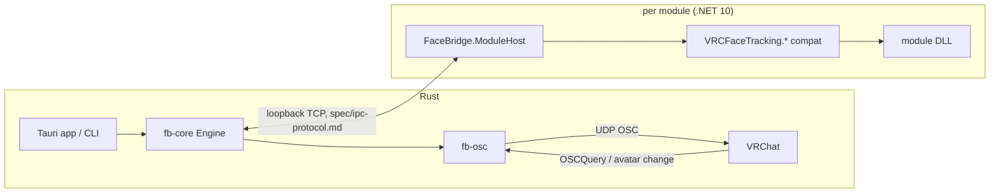

# FaceBridge

Eye and face tracking bridge for VRChat. Runs unmodified VRCFaceTracking (VRCFT) tracking modules and sends
their data to VRChat over OSC. Modules can additionally show user notifications and expose per-module settings
through the optional `FaceBridge.Sdk`.

Clean-room implementation: written from the specs in `spec/` (VRCFT's public module interface, public docs), not
from VRCFT source.

## Layout

```
crates/fb-tracking     unified tracking data model (88 expression shapes, eyes, head)
crates/fb-protocol     Rust side of the module host IPC protocol (spec/ipc-protocol.md)
crates/fb-osc          OSC encoding, VRChat parameter mapping, avatar discovery (config files + OSCQuery)
crates/fb-core         engine: module install/storage, processes, claim arbitration, merge, notifications, settings
crates/facebridge-cli  headless CLI
apps/facebridge        Tauri v2 desktop app (src-tauri/ + static ui/, no Node)
dotnet/                VRCFaceTracking.SDK / VRCFaceTracking.Core compat assemblies, FaceBridge.Sdk,
                       FaceBridge.ModuleHost (one process per module), tests
spec/                  contracts: module-api, ipc-protocol, engine-api, osc-output
test-modules/          real VRCFT module zips used by tests
```



## Requirements (Windows)

- Rust stable, MSVC toolchain (Visual Studio C++ build tools + Windows SDK; Tauri needs MSVC).
- .NET 10 SDK to build `dotnet/`; .NET 10 runtime to run modules. If the runtime is not installed system-wide, set
  `dotnetRoot` (Settings page, or `config.json`) or the `DOTNET_ROOT` environment variable.

## Build and run

```powershell
# module host (framework-dependent) -> dotnet/artifacts/module-host/FaceBridge.ModuleHost.exe
powershell -File dotnet/publish.ps1

cargo build -p facebridge          # desktop app: target/debug/facebridge.exe
cargo build -p facebridge-cli      # headless:   target/debug/facebridge-cli.exe

facebridge-cli install test-modules/FrameEyeOSC_1.0.1-claim-with-packets.zip
facebridge-cli import-vrcft        # copy modules installed for VRCFaceTracking
facebridge-cli run
```

The module host is found via `moduleHost` in config, `FACEBRIDGE_MODULE_HOST`, `<exe dir>/module-host/`, then the
dev output `dotnet/artifacts/module-host/`. Data lives in `%APPDATA%\FaceBridge` (`--data-dir` overrides).

Module update check (Settings page, on by default, stored in `app-settings.json` in the data folder): for each
module whose `module.json` `DownloadUrl` or `ModulePageUrl` points at a GitHub repository, the app asks the GitHub
API for the latest release at startup, after installs and every 6 hours, and shows "Update available" on the
module's card when the release tag is a higher version than the module's `Version`.

## Tests

```powershell
cargo test --workspace
dotnet test dotnet/FaceBridge.slnx
```

Real-module tests use `test-modules/*.zip` and the published module host; they skip when the host exe is absent.

## What the user sees from modules

Every module card on the Modules page has a collapsible **Module settings** section: first the options FaceBridge
offers for every module (today: *Allow notifications from this module*, on by default, stored per module in
`config.json`), then, below a divider, the form the module declared itself (if any).

Pop-ups (bottom right, fade in and out, on every page) show a module's notifications, its `Error`/`Critical` log
entries (first line; the full entry stays in Output) and a module that fails. With notifications turned off for a
module, its notifications and error logs only go to the Output log; a failure is always shown. This works for
unmodified VRCFaceTracking modules too: their error logs pop up, and a VRCFT notification (`EventId 7400`) becomes
a FaceBridge notification.

## Module authors: FaceBridge.Sdk

Reference `FaceBridge.Sdk` and ship `FaceBridge.Sdk.dll` in the module zip. It only depends on
`Microsoft.Extensions.Logging.Abstractions`, so the same build still loads in VRCFaceTracking, where notifications
become log entries with `EventId(7400, "VRCFT.UserNotification")`, settings fall back to a JSON file next to the
module, text fields are not shown and buttons never fire.

### Settings page

A module builds its own section of the **Module settings** panel from these fields, in the order it adds them:

| Method | Shows | Value |
| --- | --- | --- |
| `AddBool(key, label, default)` | toggle switch | `GetBool`; for turning functions on and off |
| `AddInt` / `AddFloat(key, label, default, min, max[, step])` | number box, plus a slider when both bounds are set | `GetInt` / `GetFloat`, clamped |
| `AddString(key, label, default)` | text input | `GetString` |
| `AddChoice(key, label, default, options)` | dropdown | `GetString` (the option's value) |
| `AddText(key, label, text)` | read-only text (multi-line) | the module changes it any time with `SetText`; never stored, the user cannot edit it |
| `AddButton(key, label, onPressed)` | button | none; `onPressed` runs on a thread-pool thread, after FaceBridge saved the user's pending edits |

Every method takes an optional `description` (shown under the field). Call `Declare()` once all fields are
added; call it again after adding more. `Changed` fires when the user saves a new value; `Set(key, value)` changes
a value from the module side. Field types an older FaceBridge does not know are skipped, not rejected.

```csharp
using FaceBridge.Sdk;

private readonly ModuleSettings _settings = new ModuleSettings()
    .AddBool("smoothing", "Smooth the eye data", true)
    .AddFloat("gain", "Gain", 1f, min: 0f, max: 2f, step: 0.05f, description: "Scales every expression.")
    .AddString("address", "Headset address", "", description: "Leave empty to search automatically.")
    .AddText("status", "Status", "Not connected");

public override (bool, bool) Initialize(bool eye, bool expression)
{
    _settings.AddButton("reconnect", "Reconnect now", Reconnect);
    _settings.Declare();                            // shows the module's fields in its settings panel
    _settings.Changed += (_, e) => Logger.LogInformation("{Key} changed", e.Key);
    ...
}

private void Reconnect()
{
    _settings.SetText("status", $"Connecting to {_settings.GetString("address")}\u2026");
    ...
}
```

### Notifications

`UserNotifications.Show(Logger, level, message, key)` shows a pop-up and a banner on the Home page; a new message
with the same `key` replaces the old one, and `UserNotifications.Clear(key)` removes it (for example once the
problem is solved). Use it for anything the user has to act on instead of hoping they read the log. Users can turn
a module's notifications off in its settings panel.

```csharp
UserNotifications.Show(Logger, LogLevel.Warning, "No headset answered yet. Is tracking switched on?", key: "no-headset");
// later, once data arrives:
UserNotifications.Clear("no-headset");
```

`FaceBridgeEnvironment.IsFaceBridge` tells the module which host it runs in.

To get update notices, publish GitHub releases tagged with the version (`v1.2.0` or `1.2.0`) and set `DownloadUrl`
or `ModulePageUrl` in `module.json` to the repository.
